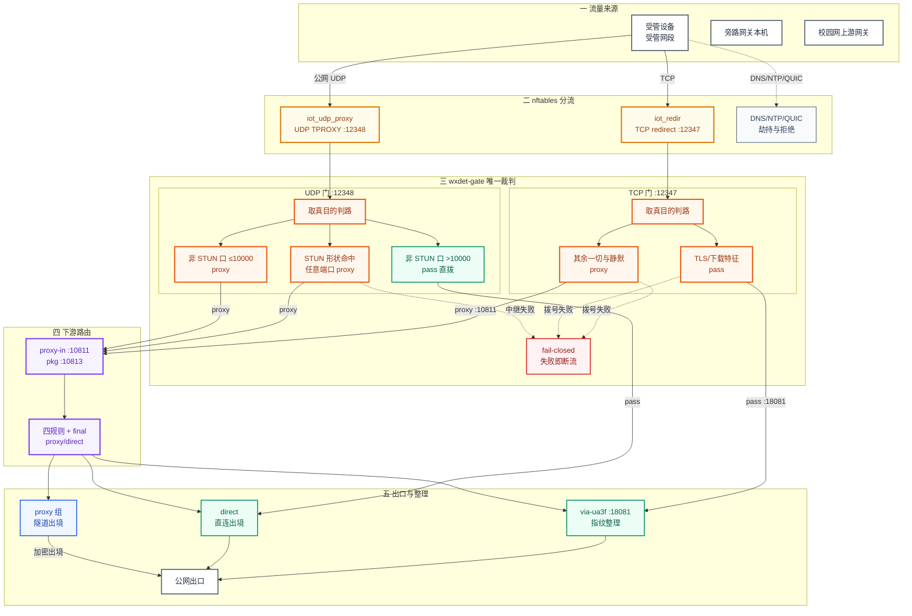

# campus-device-bypass

校园网多设备检测环境下，一套 OpenWrt 旁路网关的分流参考实现。

核心是一个前置分流门 **`wxdet-gate`**（Rust，依赖 `tokio` + `libc`，见 `gate/Cargo.toml`）：
nftables 把受管网段的流量劫持进来，它 peek 首包判定去向 —— 标准 TLS 与明文下载特征判 `pass`
转交下游入口，其余一切判 `proxy` 进代理（fail-closed）。

> 背景补充（推荐先读）：[docs/detection-and-countermeasures.md](docs/detection-and-countermeasures.md)
> —— 校园网多设备检测的 11 类手段（§0 性价比排序与检出表）、厂商实现（§2），
> 以及本方案逐项对应的对抗位置与边界（§3–§4）。

## 特性

- **首包二判分流**：标准 TLS（严判）与明文 HTTP 下载特征（Host 名单 / Range /
  URL query 签名 / 下载器 UA / 二进制后缀）判 `pass` 转交下游；其余一切
  （含静默/非标/私有协议）判 `proxy` 进加密上行，**fail-closed**（代理不可用
  宁断流，不回退、不改拨第二腿）。
- **UDP 分流**：受管网段公网 UDP 全量 TPROXY 进 gate `:12348` 判定，
  STUN 形状全量中继进隧道，assoc 失败 fail-closed；非代理 UDP 直连回源，
  下行经透明 socket 绑定对端地址回包（握手校验源的客户端可接受），
  建壳/发送失败分别计数后降级为监听 socket。
- **名单热加载**：按 `WD_KW_POLL_SEC`（默认 30 秒）轮询 mtime/size，
  变化即原子替换内存快照，不断连接；单文件缺失/读取失败保留该文件的旧快照。
- **完整事件流**：`events.jsonl` 记录连接的 open/close/uclose/error，
  大流量的 `pass/tls_direct` 改走聚合台账进 `stats.tsv`。
- **小内存调优**：TCP 拷贝缓冲默认 8KB（`WD_TCP_BUF_KB`），UDP 回包泵缓冲起于
  2KB（`WD_UDP_BUF_KB`，截断时翻倍，封顶 64KB），工作线程默认 4 个
  （`WD_WORKER_THREADS`，非法/非正回退默认）。

## 目录

```
gate/            Rust 源码（核心，含单测；`make` 跑 cargo fmt/clippy/test 门禁）
deploy/
  init.d/        procd 启停脚本（iot-tproxy、ipidfix、wxdet-gate、sing-box、ua3f）
  nftables/      8 个 nft 片段（29–36，放入 /etc/nftables.d/）
  sing-box/      下游代理接入示例（example.json） + 说明
  ua3f/          UA 归一 / L3 指纹复写 + desync 示例配置（ua3f.example）
lists/           名单样例与格式说明（dl-* 四份 gate 在读，bsf/doh-* 供下游路由）
docs/            多设备检测与对抗补充文档
```

## 1. 背景与设计思路

校园网的"多设备检测"本质是在一个账号/IP 的流量里找**多台设备、多种 OS、
多个应用账号**的痕迹；常见信号有 TTL、HTTP UA、IPID、应用层 DPI（微信/QQ/应用
商店行为）、UDP 会话数等（11 类手段的性价比排序与检出表见补充文档 §0，
厂商实现见 §2）。

应对有两条主线：

1. **收敛**：让出口看起来像"一台设备" —— TTL 统一、UA 归一、IPID 归零、
   NTP/DNS 收敛、TCP 指纹整理（本仓库 `deploy/nftables` + `deploy/ua3f`）。
2. **隐藏**：仍带识别价值的流量整体进加密隧道，让链路层看不见内容与协议特征
   （本仓库 gate 的职责：**决定哪些流量必须进隧道**）。

为什么不能只靠代理核心的域名规则？因为大量高价值流量**没有域名可匹配**：

- 私有协议帧（如 `16 F1` MMTLS 形、`02 30 31` OICQ 形、不透明二进制）不走标准
  TLS，严判不通过即落 `proxy/default`（判例见 `gate/src/classify.rs` 测试表）；
- 明文 HTTP 常见 Host 为 IP 字面（`http_host` 对 IP 字面原样返回，
  见 `gate/src/http.rs`），域名规则失效，靠 UA/后缀/query 名单兜底；
- 部分客户端首包是二进制握手，域名规则要等包进去才可能命中。

`wxdet-gate` 在 TCP 层 peek 首包直接定路：标准 TLS 与下载特征判 pass，
转交下游入口自行处理，保证吞吐与体验；其余判 proxy，
**fail-closed（只许进代理，代理不可用宁断流）**。

## 2. 系统全景

### 2.1 数据面流程图



### 2.2 哪些流量经过 gate，哪些不经过

| 流量 | 路径 | 说明 |
|---|---|---|
| TCP（除 53/1080、私网、上游网关目的） | `iot_redir` → **gate TCP :12347** | gate 二判：`pass`（TLS/下载特征）转交下游入口 / `proxy`（其余）进代理 |
| 公网 UDP（除 53/123/443/853，跳过私网/组播/广播） | `iot_udp_proxy` 全量 TPROXY → **gate UDP :12348** | gate 按 STUN 形状与目的端口判定：`proxy` 中继 / `pass` 直拨回源 |
| UDP 443（QUIC） | `iot_quic_block`（forward 链，`32-egress-fingerprint.nft`）reject | 不经 gate；逼客户端回落 TCP，才能进代理链 |
| DNS（53）、DoT/DoQ（853）、NTP（123） | `dns_force_*` / `iot_ntp_hijack`（`33-dns-ntp.nft`）→ 本机 dnsmasq/NTP | 不经 gate；上游走 DoH，加密 DNS 封堵由下游代理名单执行 |
| 私网互访、发往上游网关的管理流量 | 直接放行 | 不经 gate |
| 出境包的 L3 收尾 | TTL=64、IPID=0（`iot_mangle_post`，postrouting）+ ICMP 伪装（独立 srcnat 链 `iot_icmp_masq`） | 不经 gate；受管网段出 `br-lan` 的流量生效，分片包放过 |

### 2.3 出口

- **代理流量**：gate 拨到下游 `proxy` 组（示例：多腿远程节点，VLESS 等，
  `urltest` 按延迟选路、`tolerance` 故障转移），从自建节点封包出境。
- **转交/改写流量**：下游 `direct` 直发；`via-ua3f` 经本机 ua3f SOCKS5
  （`127.0.0.1:18081`，gate `pass` 默认拨号目标）重建连接
  （UA 归一 + L3 指纹复写）后发出。
- **出口前统一处理**：出 `br-lan` 前 nft 统一 TTL（64）/IPID（0，`mark 0xc91`
  注入包只归零 IPID）、ICMP 伪装；TCP SYN 按路由 MTU 双向 MSS 钳制
  （`34-mss-clamp.nft`，出向 postrouting + 回程 forward）；
  出口 TCP desync 由 ua3f 承担（`reorder=1/bytes=2000/packets=8`，
  `inject=0`，MitM 关，见 `deploy/ua3f/ua3f.example`）。

## 3. wxdet-gate 工作原理

启动顺序（`gate/src/main.rs`）：`load_all`（打 `dl lists: ...` 日志）→
`stats`/`log_gate`/`events` 初始化 → TCP 监听（失败退出码 1）
→ 另起名单 `watch`、`ledger` 60 秒刷盘、UDP 门（`WD_UDP_LISTEN` 为空/`off` 则不起）
→ SIGTERM/SIGINT 先刷台账再退出。启动时自抬 NOFILE 软上限到 65535
（hard 不足则取 hard；失败只告警），配合 init 脚本的 `limits nofile`。

### 3.1 TCP 判定（`gate/src/classify.rs`，按代码顺序）

| # | 条件（首包特征） | verdict/reason | 去向 |
|---|---|---|---|
| 1 | TLS ClientHello（严判：`16 03` + 记录层次版本≤0x03 + 记录长 1..18432 + 握手类型 0x01，需满 6 字节） | `pass/tls_direct` | 下游入口 |
| 2 | 明文 HTTP 且 Host ∈ 下载站名单（精确/子域后缀） | `pass/dl_direct` | 下游入口 |
| 3 | 明文 HTTP 且带 `Range:` 头（下载器/续传特征） | `pass/dl_range` | 下游入口 |
| 4 | 明文 HTTP 且 URL query 命中预签名/强制下载参数 | `pass/dl_query` | 下游入口 |
| 5 | 明文 HTTP 且 UA 命中下载器 token | `pass/dl_ua` | 下游入口 |
| 6 | 明文 HTTP 且 URL 后缀为二进制/媒体 | `pass/dl_ext` | 下游入口 |
| 7 | 其余一切（含静默/非标/私有协议/空包） | `proxy/default` | 代理（fail-closed） |

补充行为（`gate/src/tcp.rs`）：

- **peek 预算**：`:80` 用 `WD_PEEK80_MS`（默认 80ms）只读一次，不续读；
  其余端口用 `WD_PEEK_MS`（默认 400ms），peek 缓冲 1KB。
  首读 1 字节且为 `0x02/0x15/0x16/0x17/0x19` 时 150ms 内续读一次；
  首读 2..6 字节且 `0x16` 开头（排除 `0x16 0xF1`）时在同一 150ms 预算内
  补齐到 6 字节再做 TLS 严判。预算 `≤0` 立即空返回；超时/EOF/空包落
  `proxy/default`。
- **头/体隔离**：Host/Path/UA/Range 只在 header block（首个 `\r\n\r\n` 之前）内找，
  未收全头部时已收部分仍参与判定；POST body 里的特征串不再翻转判路。
- **本机目的守卫**：origdst（`SO_ORIGINAL_DST` 取 conntrack 原目的）为
  loopback/私网/链路本地/未指定即丢（`drop/local_dst`，记
  `gate_tcp_local_drop`，gate.log 5 秒限速一行），防直连监听口的自连风暴；
  只看地址类别，不看端口（`gate/src/bufpool.rs`，CGNAT `100.64/10` 不拦）。
- **拨号**：SOCKS5 建连 5 秒超时；`pass` 失败记 `gate_pass_fail` +
  `gate_dial_err` 且 reason 不变，`proxy` 失败记 `gate_proxy_fail` +
  `gate_dial_err` 且 reason 加 `_proxy_fail` 后缀；**绝无第二条腿**。
  首包写上游失败记 `gate_write_err` + error 事件。
  成功后记 `gate_conn` / `gate_pass|proxy` / `gate_rsn_<reason>` + gate.log。
- **中继**：双向拷贝按 `WD_TCP_BUF_KB`（默认 8KB）借缓冲；先返回的方向定
  closer；`tls_direct` 走聚合台账，其余走 close 事件。
  任一方向连续无字节超 `WD_TCP_IDLE_SEC`（默认 300 秒，`≤0` 禁用）即双向收尾，
  防 FIN_WAIT2/CLOSE_WAIT 常驻打满 fd。EMFILE 时 accept 退避到 1 秒（平时 50ms）。

### 3.2 UDP 判定（`gate/src/udp.rs`、`gate/src/classify.rs`）

- **取真实目的**：`IP_RECVORIGDSTADDR` + `recvmsg` 逐包从 cmsg 取 TPROXY 真目的；
  收包循环用固定 64KB 缓冲 + 256B oob。
- **目的门控**（顺序不可换）：`WD_UDP_FIXED_DST` 非空且解析成功则覆盖目的
  （调试用，生产勿设）；目的端口为 0 记 `gate_udp_origdst_invalid`；
  本机/私网/链路本地/未指定目的记 `gate_udp_local_drop` + 5 秒限速日志。
- **判定规则**（STUN 优先）：

| 条件 | verdict/reason | 去向 |
|---|---|---|
| 标准 STUN（魔数 `21 12 a4 42` + 首字节高 2bit 为 0 + `20+msgLen ≤ 包长`） | `proxy/stun_udp` | 代理（SOCKS5-UDP 中继） |
| 变种 STUN（首字节 `00/01` + 次字节 `01/02`） | `proxy/stun_udp_var` | 代理（SOCKS5-UDP 中继） |
| 魔数命中但长度声明不一致 | `pass/udp_direct`（再按端口规则：目的口 ≤10000 落 `proxy/udp_proxy`） | 见端口规则 |
| 非 STUN 且目的端口 ≤10000（含 `<20B` 短包） | `proxy/udp_proxy` | 代理（形状不足判代理，fail-closed） |
| 非 STUN 且目的端口 >10000（`udp_direct`）/ 短包（`udp_short`） | `pass/udp_direct`、`pass/udp_short` | 直连回源（直拨目的） |

- **中继语义**：`verdict==proxy` 即中继（经下游 `proxy` 入口的 SOCKS5-UDP
  associate，5 秒超时）；建链失败 fail-closed（`proxy` 失败记
  `gate_proxy_udp_fail` 且 reason 加 `_proxy_fail` 后缀，`pass` 失败记
  `gate_udp_dial_err` 且 reason 不变；只发 error 事件，**不发 uclose，不回退**）。
  建链成功记 `gate_udp_assoc` + `gate_proxy_udp|gate_pass_udp` +
  `gate_rsn_<reason>` + gate.log。
- **建链期排队**：assoc 壳先入表、建链放后台（建壳必须 50ms 内返回），期间包进
  有界队列（上限 8 条，溢出记 `gate_udp_pending_drop` 后静默丢弃）。
- **单向升级**：`verdict==proxy` 且旧腿为 `pass` 直连、`Ready`、未在升级中时，
  后台另建代理腿；成功换腿并记 `gate_udp_upgrade` + `gate_rsn_<新reason>`；
  失败记 `gate_udp_upgrade_fail`（reason 固定 `udp_upgrade_proxy_fail`），
  保持原直连腿。`proxy` assoc 收到 `pass` 包永不降级。
- **下行保源**：建壳时同步建透明 socket 绑定对端地址回包，失败记
  `gate_udp_spoof_fail` 后回退监听 socket；回包写失败记
  `gate_udp_spoof_write_fail` 后降级。
- **状态表**：key 为 `客户端|目的`，上限 512 条（满记 `gate_udp_table_full` 后整包丢弃），
  30 秒 ticker 按 120 秒 idle 回收（记 `gate_udp_expire`）并正常发 uclose。

### 3.3 术语对照（重要，字面量见 `gate/src/reason.rs`）

| 字符串 | 含义 |
|---|---|
| `proxy` | 必须走代理：拨到下游代理入口；失败不回退。`reason` 说明证据，`err/*_proxy_fail` 表示下游拨号失败 |
| `pass` | TCP：转交下游普通入口（env `WD_PASS_SOCKS`，默认直拨 `:18081` 做指纹整理）；UDP：直拨目的直连回源 |
| `tls_direct` / `dl_direct` / `dl_range` / `dl_query` / `dl_ua` / `dl_ext` / `default` | TCP reason 全集（`dl_*` 为下载转交策略标签，其中只有 `dl_direct` 带 `_direct` 后缀） |
| `stun_udp` / `stun_udp_var` / `udp_proxy` / `udp_direct` / `udp_short` | UDP reason 全集 |
| `*_proxy_fail` / `udp_upgrade_proxy_fail` | 代理拨号/升级失败（裸 reason + 后缀；`pass` 腿失败只记 `gate_pass_fail` 计数，`reason` 不加后缀）；一律 fail-closed，不回退、不改拨第二腿 |

### 3.4 名单与热加载（`gate/src/lists.rs`）

- gate 在读（`/etc/wxdet/`，路径可用 `WD_*_FILE` 覆盖）：`dl-domains.txt`、
  `dl-ua.txt`、`dl-ext.txt`、`dl-query.txt`。格式见 [lists/README.md](lists/README.md)。
  bsf/doh 样例供下游代理路由使用，gate 当前版本不读。
- 轮询 `WD_KW_POLL_SEC`（默认 30 秒，`≤0` 关闭）比较 mtime/size，
  变化即就地重载并记 `gate_dl_reload`，**不断开已有连接、不需要重启**；
  单个文件缺失不算变更、读取失败保留该文件的旧快照。
- Range 只判有无即判路，强弱（多段/`If-Range`/首字节非零为强，
  `bytes=0-`/`bytes=-N` 为弱，见 `gate/src/http.rs`）只做
  `gate_range_strong`/`gate_range_weak` 计数，不改判路。

### 3.5 观测

`/tmp/wxdet/` 下三份文件（路径可配置）：

- `gate.log`：正常行含 `ts/proto/src/dst/verdict/reason/first`
  （`first` 为首包前 24 字节小写 hex，超长补 `..`）；err 行 verdict 恒为
  `"err"`，字段序为 reason→detail→first，`detail` 按 64 字节截断补 `..`
  （`gate/src/log_gate.rs`、`gate/src/quote.rs`）。
- `stats.tsv`：`unix_ts <tab> 计数键 <tab> 值` 的追加计数（`gate_conn`、
  `gate_pass`、`gate_proxy`、`gate_pass_fail`、`gate_proxy_fail`、
  `gate_rsn_<reason>`、`gate_tls_strict_fail`、`gate_range_strong|weak`、
  `gate_udp_assoc`、`gate_proxy_udp|gate_pass_udp` 等，行格式见 `gate/src/stats.rs`；
  直连面聚合台账另出 `gate_tlsdirect_close`/`gate_tlsdirect_up_B`/
  `gate_tlsdirect_down_B`/`gate_tlsdirect_dur_ms` 四键）。
- `events.jsonl`：统一事件流，字段如下：

| event | 字段 |
|---|---|
| `open` | `ts, event, proto, src, dst, verdict, reason` |
| `close` | `…, dur_ms, up_B, down_B, closer`（>60s 加 `long:1`） |
| `uclose` | `…, dur_ms, up_pkts, down_pkts, up_B, down_B` |
| `error` | `…, verdict:"err", reason, detail` |

> `pass/tls_direct` 这类大流量普通连接只进 `stats.tsv` 计数、不进 open/close 事件流，
> 避免观测文件被冲爆（error 事件照进：`pass` 腿拨号失败会落 `err` 行；
> `proxy` 失败 reason 带 `_proxy_fail` 后缀后同样进流）。
> 它的字节与时长改走**聚合台账**：累计后每 60 秒增量刷进 `stats.tsv`
> （`gate_tlsdirect_close`/`up_B`/`down_B`/`dur_ms`，固定顺序，无流量时一行都不写；
> SIGTERM/SIGINT 会先刷盘，进程被杀最坏丢一分钟增量）。
> 另有 `udp_err.log`（`WD_UDP_ERR_LOG`）：收包硬错的 6 段 tab 行
> （`unix/client/n=/od=/err=/first=`，`first` 为前 16 字节 hex、无后缀），5 秒限速。

## 4. 快速开始

### 4.1 拓扑与依赖

参考拓扑：路由器作**旁路网关**（本机 LAN IP + 一个受管网段接口），上游是校园网
网关。受管设备连在受管网段（示例 `192.168.2.0/24`）。

依赖组件（都可替换）：

- 下游代理套件（示例：[sing-box](https://github.com/SagerNet/sing-box)）：提供普通/敏感入口、路由与出口组；
- 一条加密隧道（示例：远程 VLESS 节点，多腿 urltest 选路）；
- [UA3F](https://github.com/SunBK201/UA3F)（可选但推荐）：UA/L3 指纹归一 + 出口 TCP desync；
- nftables（fw4）、dnsmasq、https-dns-proxy 等 OpenWrt 原生件。

### 4.2 编译与安装

```sh
make            # check（fmt --check + clippy + test）+ 本机构建
make arm64      # 交叉编译 linux/arm64（musl 静态，aarch64-unknown-linux-musl）

# 部署到路由器（替换 <router>）
scp gate/target/aarch64-unknown-linux-musl/release/wxdet-gate root@<router>:/tmp/wxdet-gate
ssh root@<router> '/etc/init.d/wxdet-gate stop && cp /tmp/wxdet-gate /usr/bin/wxdet-gate && chmod 755 /usr/bin/wxdet-gate && /etc/init.d/wxdet-gate start'
scp deploy/init.d/wxdet-gate   root@<router>:/etc/init.d/wxdet-gate
ssh root@<router> 'chmod 755 /etc/init.d/wxdet-gate && /etc/init.d/wxdet-gate enable && /etc/init.d/wxdet-gate start'

# 名单（按需裁剪后放好，去掉 .example 后缀）
scp lists/dl-domains.example   root@<router>:/etc/wxdet/dl-domains.txt
# …其余文件同理，见 lists/README.md
```

> 注：构建产物不入库（`gate/target/` 已忽略）；`make` 门禁为 `cargo fmt/clippy/test` 全绿，
> `cargo test` 须带 `--test-threads=1`（测试共享进程级句柄，串行是定案）。

注意：gate 在运行时不能直接 `scp` 覆盖 `/usr/bin/wxdet-gate`（ETXTBSY，首次装
没事、二次升级会踩），先传 `/tmp` 再停服务替换，见 [gate/README.md](gate/README.md)。
init 脚本会建 `/tmp/wxdet`、抬 `nofile` 到 65535、声明 `WD_TCP_IDLE_SEC=300`、
崩溃自动拉起（`respawn 3600 5 5`），见 `deploy/init.d/wxdet-gate`。

### 4.3 nftables 接入

```sh
scp deploy/nftables/*.nft root@<router>:/etc/nftables.d/
ssh root@<router> 'fw4 reload'   # 首次接入整体加载一次
```

注意：

- 先把下游代理 / 隧道起好**再**接入重定向，否则流量会 fail-closed 断流；
- 首次 `fw4 reload` 之后，日常改动优先用 `nft add/delete rule` 热修 + 同步文件，
  避免反复 reload 清零全部计数器（破坏观测基线）；
- `deploy/nftables/README.md` 有每条规则的说明与依赖（策略路由、flow offloading
  必须关闭等）；
- `deploy/nftables/31-gate-udp.nft` 依赖 `deploy/init.d/iot-tproxy` 的策略路由
  （`fwmark 0x100 → lookup 100` + 本地投递路由），切换前后 `conntrack -D -p udp`。

### 4.4 sing-box 接入

`deploy/sing-box/example.json` 是最小可跑骨架：proxy-in 入站、proxy 出口组、
via-ua3f 出口、路由规则顺序全部保留语义。接入步骤与细节：
[deploy/sing-box/README.md](deploy/sing-box/README.md)。

```sh
mkdir -p /tmp/wxdet
sing-box check -c /etc/sing-box/config.json
/etc/init.d/sing-box restart
```

路由四规则 + final（顺序语义关键）：`inbound == proxy-in/pkg → proxy` 最前；
私网段 → `direct`；本地域名（占位）→ `direct`；`network: tcp` 兜底 → `via-ua3f`；
`final: direct`（UDP 无兜底，默认直连）。

### 4.5 ua3f 接入（可选但推荐）

`deploy/ua3f/ua3f.example` 给出"作为 SOCKS5 上游 + L3 指纹整理 + desync"的配置形态
（UA 全量归一、去时间戳、窗口统一、TTL 复写、reorder 全端口等，IPID 复写保持关闭，
由 nft 独立处理）。安装方式见上游文档。

### 4.6 zapret（已退役）

> 独立 `zapret`/nfqws 方案已退役并删除：fake 包曾毒化近端游戏前置导致登录失败；
> desync 现由 ua3f 接管（`reorder=1/bytes=2000/packets=8`，全端口，`inject=0`，MitM 关），
> 见 `deploy/ua3f/ua3f.example`。

### 4.7 验证

```sh
# 1) gate 起来了 / 名单加载
ssh root@<router> 'logread | grep wxdet-gate | tail'
ssh root@<router> 'tail /tmp/wxdet/gate.log; tail -3 /tmp/wxdet/stats.tsv'

# 2) nft 计数器在动（redirect/tproxy 命中）
ssh root@<router> 'nft list chain inet fw4 iot_redir; nft list chain inet fw4 iot_udp_proxy'

# 3) 端到端：经 10808 出口访问
curl -x socks5h://127.0.0.1:10808 -sS -o /dev/null -w '%{http_code}\n' https://example.com
```

### 4.8 观测速查

```sh
tail -f /tmp/wxdet/gate.log          # 逐连接 verdict/reason
awk -F'\t' '{c[$2]+=$3} END{for(k in c) print c[k],k}' /tmp/wxdet/stats.tsv | sort -rn | head
tail -5 /tmp/wxdet/events.jsonl      # 统一事件流
```

## 5. 配置项（环境变量，`gate/src/config.rs`，启动时读一次）

| 变量 | 默认 | 说明 |
|---|---|---|
| `WD_LISTEN` | `0.0.0.0:12347` | TCP 门监听地址 |
| `WD_UDP_LISTEN` | `0.0.0.0:12348` | UDP 门监听地址；`off`/空 关闭 UDP 门 |
| `WD_PASS_SOCKS` | `127.0.0.1:18081` | 下游普通入口；`pass` verdict 的拨号目标（示例指向 UA/指纹整理入口） |
| `WD_PROXY_SOCKS` | `127.0.0.1:10811` | 下游代理入口；`proxy` verdict 的拨号目标 |
| `WD_DL_DOM_FILE` / `WD_DL_UA_FILE` / `WD_DL_EXT_FILE` / `WD_DL_QUERY_FILE` | `/etc/wxdet/dl-*.txt` | 下载站/下载器名单（dl-query 为 URL 参数签名） |
| `WD_PEEK_MS` | `400` | 非 80 首包等待（ms） |
| `WD_PEEK80_MS` | `80` | `:80` opportunistic 短读（ms） |
| `WD_KW_POLL_SEC` | `30` | 名单轮询周期（秒），`<=0` 关闭轮询 |
| `WD_TCP_IDLE_SEC` | `300` | TCP 中继空闲收尾（秒），`<=0` 禁用；防 FIN_WAIT2/CLOSE_WAIT 常驻打满 fd |
| `WD_UDP_BUF_KB` / `WD_TCP_BUF_KB` / `WD_WORKER_THREADS` | `2` / `8` / `4` | UDP assoc 泵起始缓冲 / TCP 拷贝缓冲 / 工作线程（非法/非正回退默认） |
| `WD_LOG` / `WD_STATS` / `WD_EVENTS` | `/tmp/wxdet/gate.log` / `stats.tsv` / `events.jsonl` | 观测输出 |
| `WD_UDP_FIXED_DST` | 空 | 调试用：覆盖 origdst，固定中继目的（生产勿设） |
| `WD_UDP_ERR_LOG` | `/tmp/wxdet/udp_err.log` | UDP 门错误采样日志（5 秒限速） |

解析口径：字符串变量显式空串回退默认、不 trim；整数变量整串不可解析
（含空串、带后缀、含空白）回退默认，`0`/负数对继承变量原样采用、不钳制。

## 6. 排障 FAQ

**Q：判 `proxy` 的流量为什么断流而不是回退直连？**
设计如此（fail-closed）：这些流量靠协议特征暴露多设备/账号信号，直连等于自曝；
代理不可用时宁断流。恢复下游代理（检代理入口侦听/远端节点）即恢复。

**Q：代理全挂后整个受管网段都上不了网？**
不会全断：只有被判 `proxy` 的流量受影响（`block` 是下游代理的出站动作，
gate 只产出 pass/proxy/drop/err），`pass` 类（TLS/下载等）转交下游入口后按下游路由处理；
但 `proxy` 类会持续失败直到下游恢复。应急可先摘掉重定向链：
`nft flush chain inet fw4 iot_redir`（再处理 `iot_udp_proxy` 的 mark/TPROXY 规则并
`conntrack -D -p udp`），停 gate 服务，等修复后再接回。

**Q：能不能先只观察不改流量？**
可以：只跑 gate（不接 nft 重定向）用 `WD_UDP_FIXED_DST`/`WD_PEEK_MS` 调试，
看 `gate.log` 的 verdict 分布。正式接入前建议先小范围验证。

**Q：端口容易搞混。**
本方案：`18081` = 下游普通入口（gate `pass` 默认拨号目标，ua3f SOCKS5）；
`10811` = `proxy` 专用 loopback 入站（gate `proxy` 拨号目标，下游 `proxy` 组出口）；
`10808` = 下游 socks/mixed 示例入口；`10813` = 本机软件源 redirect 入站；
`18082` = hysteria 隧道 SOCKS（`proxy` 组 `realm` 腿）；
`12347/12348` = gate TCP/UDP。
注意 scheme 要对：把 `socks5h://` 打到 HTTP 代理上会得到
`malformed HTTP request` + 超时，是假故障。

**Q：名单改了要重启吗？**
不用。30 秒内自动热加载；只有下游代理侧路由需要按你的配置方式重新生成并
restart 下游代理（gate 为下载站/STUN 的唯一判点，下游不再为它们设早位规则；
DoH 封堵由下游 block 名单执行，示例 `block` 出站当前空闲）。

**Q：观测文件会不会无限涨？**
项目本身不做轮转：`stats.tsv`/`events.jsonl`/`gate.log` 的轮转与截断由系统
logrotate/cron 自理。注意**截断保持 inode**（`cat tmp > f` / `: > f`），
消费方若按"行数游标"增量读，换 inode 会被当成新文件重读。

**Q：内存/CPU 占用？**
gate 是纯转发进程（Rust，无 GC）。缓冲按需取用（TCP 8KB、UDP 泵起于 2KB），
CPU 开销主要在 peek 等待与字节匹配；大头在下游代理与隧道。

## 7. 多设备检测对抗（摘要）

| 检测项 | 本方案对应 |
|---|---|
| 全端口 TCP 载荷特征 | ua3f reorder（前 2KB/前 8 包，全端口，见 `deploy/ua3f/ua3f.example`） |
| TTL | 出口统一 64（nft 出向改 64 + ua3f L3 重写 64） |
| IPID | nft 原子包置 0 + 独立 `ipidfix` 服务补 DF 包置 0（ua3f 该项保持关闭） |
| MSS | `34-mss-clamp.nft`：出向按路由 MTU + 回程 forward 双向钳制 |
| ICMP | 独立 srcnat 链伪装 |
| HTTP UA / TLS 指纹 | `via-ua3f` 出口 + ua3f `l3_rewrite_*`（UA 归一、去时间戳、窗口统一） |
| NTP | `33-dns-ntp.nft`：UDP 123 劫持到本机 |
| DNS/DoH 画像 | 53 劫持到 dnsmasq→DoH、TCP/UDP 853 拒绝；DoH 名单封堵由下游执行，gate 不判 `block` |
| DPI 应用特征（微信/QQ/抖音/游戏） | gate 首包二判（非 TLS/下载特征即 `proxy`） + 下载名单 → `pass` |
| UDP 会话/STUN | `31-gate-udp.nft` 全量 TPROXY + gate STUN 判定与中继 |
| QUIC 绕过 | `iot_quic_block`（`32-egress-fingerprint.nft`，forward 链）拒绝，逼回 TCP 进代理链 |
| 特定网段 | `29-spec-drop.nft` 参考形态（目的集按环境填；文件本身为注释模板） |
| IPv6 | `iot_v6drop`（`32-egress-fingerprint.nft`，forward 链）全 DROP，只留 v4 单栈 |
| 保留口 | `drop1080`（`30-gate-redir.nft`）：封受管网段直连 1080 |
| TCP 全量出口 | `network: tcp` 全量 → `via-ua3f`（含 443，无单独 443 规则） |
| 私有客户端心跳 | 不在本仓库范围（认证层问题） |

完整原理、厂商实现与边界讨论见
[docs/detection-and-countermeasures.md](docs/detection-and-countermeasures.md)。

## 8. 合规与风险

- 绕过校园网的多设备限制/计费策略通常**违反学校网络管理规定**，可能触发断网、
  限速、冻结账号等处罚；请在自有或获授权的网络中、以学习与研究为目的使用。
- 本方案会改写指纹、封堵加密 DNS、拒绝 QUIC，可能影响个别应用（银行/政务
  App 对 DNS 劫持敏感）；上量前先观察日志、灰度验证。
- 任何"收敛/伪装"都不保证对所有检测维度有效；检测强度会升级，风险自负。

## 9. 维护说明

- `gate/`（Rust）、`deploy/`、`lists/`、`docs/` 各自独立演进，改动建议附测试
  （`make` 会跑 `cargo fmt/clippy/test`，`cargo test` 带 `--test-threads=1`）。
- 判决字面量（`pass`/`proxy`）、reason（`tls_direct`/`dl_*`/`default`/
  `stun_udp`/`stun_udp_var`/`udp_proxy`/`udp_direct`/`udp_short`）与统计键
  （`gate_*`）以 `gate/src/reason.rs`、`gate/src/stats.rs` 为准，不得自由拼接。
- 环境变量与默认值以 `gate/src/config.rs` 为准；部署示例的占位
  （`tunnel.example.com` 等）按你的环境替换。

## 10. 致谢

- [SagerNet/sing-box](https://github.com/SagerNet/sing-box) —— 代理核心与路由；
- [SunBK201/UA3F](https://github.com/SunBK201/UA3F) —— UA/L3 指纹归一；
- [dibdot/DoH-IP-blocklists](https://github.com/dibdot/DoH-IP-blocklists)、
  [Sekhan/TheGreatWall](https://github.com/Sekhan/TheGreatWall) —— DoH 名单上游。

## License

[MIT](LICENSE)
