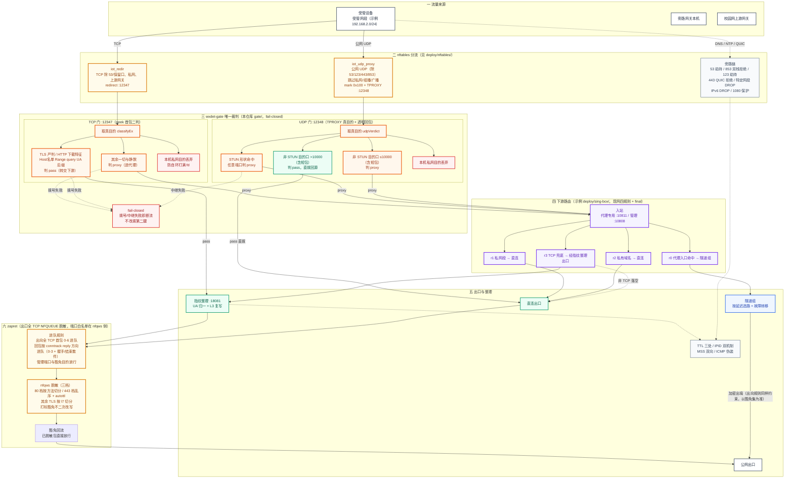

# campus-device-bypass

校园网多设备检测环境下，一套 OpenWrt 旁路网关的分流参考实现。

核心是一个前置分流门 **`wxdet-gate`**（Go，无第三方依赖）：nftables 把受管网段的
流量劫持进来，它 peek 首包判定去向 —— 标准 TLS 与明文下载特征判 `pass` 转交
下游入口，其余一切判 `proxy` 进代理（fail-closed）。

> 背景补充（推荐先读）：[docs/detection-and-countermeasures.md](docs/detection-and-countermeasures.md)
> —— 校园网多设备检测的 11 类手段、厂商实现，以及本方案逐项对应的对抗位置与边界。

## 特性

- **首包二判分流**：标准 TLS（严判）与明文 HTTP 下载特征（Host 名单 / Range /
  URL query 签名 / 下载器 UA / 二进制后缀）判 `pass` 转交下游；其余一切
  （含静默/非标/私有协议）判 `proxy` 进加密上行，**fail-closed**（代理不可用
  宁断流，不回退）。
- **UDP 分流**：受管网段公网 UDP 全量 TPROXY 进 gate `:12348` 判定，
  STUN 形状全量中继进隧道，assoc 失败 fail-closed；非代理 UDP 直连回源，
  下行经透明 socket 欺骗源地址（握手校验源的客户端可接受），失败降级。
- **名单热加载**：30 秒按 mtime/size 热更新，不断连接；进程内存占用按小内存
  路由器调优（`GOGC=40 GOMEMLIMIT=16MB` 起步）。
- **完整事件流**：`events.jsonl` 记录每条连接的开/关/错误与字节数，供观测归因。

## 目录

```
gate/            Go 源码（核心，含单测）
deploy/
  init.d/        procd 启停脚本（wxdet-gate、TPROXY 策略路由）
  nftables/      分流/指纹/DNS 的 nft 片段（放入 /etc/nftables.d/）
  sing-box/      下游代理接入示例（以 sing-box 为例） + 说明
  ua3f/          UA 归一 / L3 指纹复写示例配置
lists/           名单样例与格式说明（dl-* 四份 gate 在读，bsf/doh-* 供下游路由）
docs/            多设备检测与对抗补充文档
```

## 1. 背景与设计思路

校园网的"多设备检测"本质是在一个账号/IP 的流量里找**多台设备、多种 OS、
多个应用账号**的痕迹；常见信号有 TTL、HTTP UA、IPID、应用层 DPI（微信/QQ/应用
商店行为）、UDP 会话数等（详见补充文档）。

应对有两条主线：

1. **收敛**：让出口看起来像"一台设备" —— TTL 统一、UA 归一、IPID 归零、
   NTP/DNS 收敛、TCP 指纹整理（本仓库 `deploy/nftables` + `deploy/ua3f`）。
2. **隐藏**：仍带识别价值的流量整体进加密隧道，让链路层看不见内容与协议特征
   （本仓库 gate 的职责：**决定哪些流量必须进隧道**）。

为什么不能只靠代理核心的域名规则？因为大量高价值流量**没有域名可匹配**：

- 私有协议帧（MMTLS/OICQ/MSF/TCP-STUN）不走标准 TLS，嗅探不出 SNI；
- 明文 HTTP 常见 Host 为 IP 字面，域名规则失效；
- 部分客户端首包是二进制握手，域名规则要等包进去才可能命中。

`wxdet-gate` 在 TCP 层 peek 首包直接定路：标准 TLS 与下载特征判 pass，
转交下游入口自行处理，保证吞吐与体验；其余判 proxy，
**fail-closed（只许进代理，代理不可用宁断流）**。

## 2. 系统全景

### 2.1 数据面流程图



### 2.2 哪些流量经过 gate，哪些不经过

| 流量 | 路径 | 说明 |
|---|---|---|
| TCP（除 53/1080、私网、上游网关目的） | `iot_redir` → **gate TCP :12347** | gate 二判：`pass`（TLS/下载特征）转交下游入口 / `proxy`（其余）进代理 |
| 公网 UDP（除 53/123/443/853，跳过私网/组播/广播） | `iot_udp_proxy` 全量 TPROXY → **gate UDP :12348** | gate 判定 STUN 形状与目的端口：`proxy` 中继 / `pass` 直拨回源 |
| UDP 443（QUIC） | `iot_quic_block`（forward 链）reject | 不经 gate；逼客户端回落 TCP，才能进代理链 |
| DNS（53）、DoT（853）、NTP（123） | `dns_force_*` / `iot_ntp_hijack` → 本机 dnsmasq/NTP | 不经 gate；上游 DoH，加密 DNS 封堵由下游代理名单执行 |
| 私网互访、发往上游网关的管理流量 | 直接放行 | 不经 gate |
| 所有出境包的 L3 收尾 | TTL=64、IPID=0（mangle/postrouting）+ ICMP 伪装（独立 srcnat 链） | 不经 gate；受管网段全部流量生效 |

### 2.3 出口

- **代理流量**：gate 拨到下游 `proxy` 组（示例：多腿远程节点，VLESS/anytls 等，
  urltest 自动选路与故障转移），从自建节点封包出境。
- **转交/改写流量**：下游 `direct` 直发；`via-ua3f` 经本机 ua3f SOCKS5
  重建连接（UA 归一 + L3 指纹复写）后发出。
- **出口前统一处理**：出 `br-lan` 前 nft 统一 TTL/IPID、ICMP 伪装；
  出口的 TCP SYN 还会过 ua3f 自带的 NFQUEUE 钩子做 TCP 层指纹整理（入队范围
  与队列号由 ua3f 自己管理，见上游文档）。要注意让这个钩子豁免 zapret 打过标的
  包，否则两套改写会互相干扰。

## 3. wxdet-gate 工作原理

### 3.1 TCP 判定（`gate/main.go` `classify`，按代码顺序）

| # | 条件（首包特征） | verdict/reason | 去向 |
|---|---|---|---|
| 1 | TLS ClientHello（严判：`16 03` + 次版本≤0x03 + 记录长 1..18432 + 握手类型 0x01） | `pass/tls_direct` | 下游入口 |
| 2 | 明文 HTTP 且 Host ∈ 下载站名单 | `pass/dl_direct` | 下游入口 |
| 3 | 明文 HTTP 且带 `Range:` 头（下载器/续传特征） | `pass/dl_range` | 下游入口 |
| 4 | 明文 HTTP 且 URL query 命中预签名/强制下载参数 | `pass/dl_query` | 下游入口 |
| 5 | 明文 HTTP 且 UA 命中下载器 token | `pass/dl_ua` | 下游入口 |
| 6 | 明文 HTTP 且 URL 后缀为二进制/媒体 | `pass/dl_ext` | 下游入口 |
| 7 | 其余一切（含静默/非标/私有协议/`:80` 空载荷） | `proxy/default` | 代理（fail-closed） |

补充行为：

- **`:80` 短读**：`WD_PEEK80_MS`（默认 80ms）opportunistic 短读 —— 客户端建连即发
  请求，局域网内必在途；读到即正常判定，静默/非 HTTP 落 `proxy/default`。
- **非 80 短读补齐**：`0x16` 开头但首读不足 6 字节时，在同一 150ms 预算内续读到
  6 字节再做 TLS 严判。
- **头/体隔离**：Host/Path/UA/Range 只在 header block（首个 `\r\n\r\n` 之前）内找，
  POST body 里的特征串不再翻转判路。
- **本机目的守卫**：origdst 为本机/私网/链路本地/未指定即丢（`drop/local_dst`），
  防直连监听口的自连风暴；只看地址类别，不看端口。

### 3.2 UDP 判定（`gate/udp.go`）

- **取真实目的**：`IP_RECVORIGDSTADDR` + `recvmsg` 逐包从 cmsg 取 DNAT 前的
  目的地址。注意：`SO_ORIGINAL_DST` 在未连接的 UDP 监听套接字上恒
  `EPROTONOSUPPORT`，不要回退到它。
- **判定规则**：

| 条件 | verdict/reason | 去向 |
|---|---|---|
| 标准 STUN 魔数 `21 12 a4 42` + 首 2bit 为 0 + 长度一致 | `proxy/stun_udp` | 代理（SOCKS5-UDP 中继） |
| 变种 STUN（`0001/0101` 包型，事务配对） | `proxy/stun_udp_var` | 代理（SOCKS5-UDP 中继） |

> 长度声明不一致的 STUN 形包（`20+msgLen > 包长`）先落 `udp_direct`，再按目的端口
> 走端口规则（低端口归 `udp_proxy`）：形状与端口两段式，见 `gate/udp.go`。
| 非 STUN 且目的端口 ≤10000 | `proxy/udp_proxy` | 代理（SOCKS5-UDP 中继） |
| 短包（<20B）且目的端口 ≤10000 | `proxy/udp_proxy` | 代理（形状不足判代理，fail-closed） |
| 短包（<20B）/非 STUN 且目的端口 >10000 | `pass/udp_short`、`pass/udp_direct` | 直连回源（直拨目的） |

- **中继语义**：`verdict==proxy` 即中继（经下游 `proxy` 入口的 SOCKS5-UDP associate）；
  **assoc 失败即丢包（fail-closed），不回退直连**。`pass` 腿直拨目的直连回源；
  pass→proxy 单向升级保留（收到代理形状包即升级，不降级）。
- **下行保源**：每个 assoc 建透明 socket 绑定对端地址回包（握手校验源的客户端
  可接受），失败降级为监听 socket（各记一个计数器，只降级一次）。
- **状态表**：按 `客户端 + 目的` 维护 assoc，空闲 120s 回收，上限 512 条，
  防环丢弃 loopback/私网/链路本地/未指定目的。

### 3.3 术语对照（重要）

| 字符串 | 含义 |
|---|---|
| `proxy` | 必须走代理：拨到下游代理入口；失败不回退。`reason` 说明证据，`err/*_proxy_fail` 表示下游拨号失败 |
| `pass` | TCP：转交下游普通入口（env `WD_PASS_SOCKS`，默认直拨 `:18081` 做指纹整理）；UDP：直拨目的直连回源 |
| `dl_*` | 下载站/下载器转交策略标签（`reason` 证据名保留 `_direct` 后缀） |
| `*_proxy_fail` | 代理拨号失败（`reason` 原样 + 后缀）；`pass` 腿失败只记 `gate_pass_fail` 计数，`reason` 不加后缀；一律 fail-closed，不回退、不改拨第二腿 |

### 3.4 名单与热加载

- gate 在读（`/etc/wxdet/`，路径可用 `WD_*_FILE` 覆盖）：`dl-domains.txt`、
  `dl-ua.txt`、`dl-ext.txt`、`dl-query.txt`。格式见 [lists/README.md](lists/README.md)。
  bsf/doh 样例供下游代理路由使用，gate 当前版本不读。
- 30 秒轮询 mtime/size（`WD_KW_POLL_SEC`），变化即原子替换内存快照，
  **不断开已有连接、不需要重启**；单个文件缺失/读取失败保留旧快照。

### 3.5 观测

`/tmp/wxdet/` 下三份文件（路径可配置）：

- `gate.log`：每条连接一行 JSON（`ts/src/dst/verdict/reason/first`，`first` 为首包
  前 24 字节 hex）。
- `stats.tsv`：`unix_ts <tab> 计数键 <tab> 值` 的追加计数（`gate_conn`、
  `gate_proxy`、`gate_proxy_fail`、`gate_rsn_<reason>`、`gate_udp_assoc` 等；
  直连面聚合台账另出 `gate_tlsdirect_close`/`gate_tlsdirect_up_B`/
  `gate_tlsdirect_down_B`/`gate_tlsdirect_dur_ms` 四键）。
- `events.jsonl`：统一事件流，字段如下：

| event | 字段 |
|---|---|
| `open` | `ts, event, proto, src, dst, verdict, reason` |
| `close` | `…, dur_ms, up_B, down_B, closer`（>60s 加 `long:1`） |
| `uclose` | `…, dur_ms, up_pkts, down_pkts, up_B, down_B` |
| `error` | `…, verdict:"err", reason, detail` |

> `pass/tls_direct` 这类大流量普通连接只进 `stats.tsv` 计数、不进 open/close 事件流，
> 避免观测文件被冲爆（error 事件照进：`pass` 腿拨号失败会落 `err` 行）。
> 它的字节与时长改走**聚合台账**：累计后每分钟增量刷进 `stats.tsv`
> （`gate_tlsdirect_close`/`up_B`/`down_B`/`dur_ms`，按 key 求和即得总量与均时长），
> 无流量时一行都不写；进程被杀最坏丢一分钟增量。

## 4. 快速开始

### 4.1 拓扑与依赖

参考拓扑：路由器作**旁路网关**（本机 LAN IP + 一个受管网段接口），上游是校园网
网关。受管设备连在受管网段（示例 `192.168.2.0/24`）。

依赖组件（都可替换）：

- 下游代理套件（示例：[sing-box](https://github.com/SagerNet/sing-box)）：提供普通/敏感入口、路由与出口组；
- 一条加密隧道（示例：远程 VLESS / anytls 节点，多腿 urltest 选路）；
- [UA3F](https://github.com/SunBK201/UA3F)（可选但推荐）：UA/L3 指纹归一；
- [zapret](https://github.com/bol-van/zapret) / nfqws（可选但推荐）：出口全 TCP 的 DPI 脱敏；
- nftables（fw4）、dnsmasq、https-dns-proxy 等 OpenWrt 原生件。

### 4.2 编译与安装

```sh
make            # gofmt + go vet + go test + 本机构建（产物 gate/wxdet-gate）
make arm64      # 交叉编译 linux/arm64

# 部署到路由器（替换 <router>）
scp gate/wxdet-gate            root@<router>:/usr/bin/wxdet-gate
scp deploy/init.d/wxdet-gate   root@<router>:/etc/init.d/wxdet-gate
ssh root@<router> 'chmod 755 /etc/init.d/wxdet-gate && /etc/init.d/wxdet-gate enable && /etc/init.d/wxdet-gate start'

# 名单（按需裁剪后放好，去掉 .example 后缀）
scp lists/dl-domains.example   root@<router>:/etc/wxdet/dl-domains.txt
# …其余文件同理，见 lists/README.md
```

注意：gate 在运行时不能直接 `scp` 覆盖 `/usr/bin/wxdet-gate`（ETXTBSY，首次装
没事、二次升级会踩），先传 `/tmp` 再停服务替换，见 [gate/README.md](gate/README.md)。

### 4.3 nftables 接入

```sh
scp deploy/nftables/*.nft root@<router>:/etc/nftables.d/
ssh root@<router> 'fw4 reload'   # 首次接入整体加载一次
```

注意：

- 先把下游代理 / 隧道起好**再**接入重定向，否则流量会 fail-closed 断流；
- 首次 `fw4 reload` 之后，日常改动优先用 `nft add/delete rule` 热修 + 同步文件，
  避免反复 reload 清零全部计数器（破坏观测基线）；
- `deploy/nftables/README.md` 有每条规则的说明与依赖（策略路由、flow offloading
  必须关闭等）；
- `deploy/nftables/31-gate-udp.nft` 依赖 `deploy/init.d/iot-tproxy` 的策略路由。

### 4.4 sing-box 接入

`deploy/sing-box/example.json` 是最小可跑骨架：proxy-in 入站、proxy 出口组、
via-ua3f 出口、路由规则顺序全部保留语义。接入步骤与细节：
[deploy/sing-box/README.md](deploy/sing-box/README.md)。

```sh
mkdir -p /tmp/wxdet
sing-box check -c /etc/sing-box/config.json
/etc/init.d/sing-box restart
```

### 4.5 ua3f 接入（可选但推荐）

`deploy/ua3f/ua3f.example` 给出"作为 SOCKS5 上游 + L3 指纹整理"的配置形态
（UA 全量归一、去时间戳、窗口统一等）。UA3F 自带 NFQUEUE 钩子会处理出口的
TCP SYN（入队范围与队列号由 ua3f 自己管理），安装方式见上游文档。

### 4.6 zapret 接入（可选但推荐）

`deploy/zapret/` 承担出口全 TCP 的 DPI 脱敏（desync 只由它做，ua3f 的 desync
开关保持关闭）：

- `zapret.nft` → `/etc/zapret.nft`。**不能**放 `/etc/nftables.d/`：会被 include 进
  `table inet fw4` 上下文，嵌套 table 语法错误会让下次 fw4 启动失败；
- `zapret.config.example` → `/etc/config/zapret`（去掉 `.example`），策略只改这份；
- `zapret_guard.sh` → `/root/zapret_guard.sh`（cron 每分钟），`init.d/zapret` →
  `/etc/init.d/zapret`（表恢复 + 端点豁免刷新）。

`nozapret` 集必须填自家隧道端点 IP，否则 fake 包会打坏隧道。细节见
[deploy/zapret/README.md](deploy/zapret/README.md)。

### 4.7 验证

```sh
# 1) gate 起来了 / 名单加载
ssh root@<router> 'logread | grep wxdet-gate | tail'
ssh root@<router> 'tail /tmp/wxdet/gate.log; tail -3 /tmp/wxdet/stats.tsv'

# 2) nft 计数器在动（redirect/tproxy 命中）
ssh root@<router> 'nft list chain inet fw4 iot_redir; nft list chain inet fw4 iot_udp_proxy'

# 3) 端到端：经 10808 出口访问
curl -x socks5h://127.0.0.1:10808 -sS -o /dev/null -w '%{http_code}\n' https://example.com
```

### 4.8 观测速查

```sh
tail -f /tmp/wxdet/gate.log          # 逐连接 verdict/reason
awk -F'\t' '{c[$2]+=$3} END{for(k in c) print c[k],k}' /tmp/wxdet/stats.tsv | sort -rn | head
tail -5 /tmp/wxdet/events.jsonl      # 统一事件流
```

## 5. 配置项（环境变量）

| 变量 | 默认 | 说明 |
|---|---|---|
| `WD_LISTEN` | `0.0.0.0:12347` | TCP 门监听地址 |
| `WD_UDP_LISTEN` | `0.0.0.0:12348` | UDP 门监听地址；`off`/空 关闭 UDP 门 |
| `WD_PASS_SOCKS` | `127.0.0.1:18081` | 下游普通入口；`pass` verdict 的拨号目标（示例指向 UA/指纹整理入口） |
| `WD_PROXY_SOCKS` | `127.0.0.1:10811` | 下游代理入口；`proxy` verdict 的拨号目标 |
| `WD_DL_DOM_FILE` / `WD_DL_UA_FILE` / `WD_DL_EXT_FILE` / `WD_DL_QUERY_FILE` | `/etc/wxdet/dl-*.txt` | 下载站/下载器名单（dl-query 为 URL 参数签名） |
| `WD_PEEK_MS` | `400` | 非 80 首包等待（ms） |
| `WD_PEEK80_MS` | `80` | `:80` opportunistic 短读（ms） |
| `WD_KW_POLL_SEC` | `30` | 名单轮询周期（秒），`<=0` 关闭（旧名见 §9 映射，迁移须同步改启动脚本 env） |
| `WD_LOG` / `WD_STATS` / `WD_EVENTS` | `/tmp/wxdet/gate.log` / `stats.tsv` / `events.jsonl` | 观测输出 |
| `WD_UDP_FIXED_DST` | 空 | 调试用：跳过 origdst，固定中继目的（生产勿设） |
| `WD_UDP_ERR_LOG` | `/tmp/wxdet/udp_err.log` | UDP 门错误采样日志（每进程 5 秒一行） |

## 6. 排障 FAQ

**Q：判 `proxy` 的流量为什么断流而不是回退直连？**
设计如此（fail-closed）：这些流量靠协议特征暴露多设备/账号信号，直连等于自曝；
代理不可用时宁断流。恢复下游代理（检代理入口侦听/远端节点）即恢复。

**Q：代理全挂后整个受管网段都上不了网？**
不会全断：只有被判 `proxy` 的流量受影响（`block` 是下游代理的出站动作，gate 只产出 pass/proxy/drop/err），`pass` 类（TLS/下载等）转交下游入口后按下游路由处理；但 `proxy` 类会持续失败直到下游恢复。应急可先摘掉重定向链：
`nft flush chain inet fw4 iot_redir`（再处理 `iot_udp_proxy` 的 mark/TPROXY 规则并 `conntrack -D -p udp`），
停 gate 服务，等修复后再接回。

**Q：能不能先只观察不改流量？**
可以：只跑 gate（不接 nft 重定向）用 `WD_UDP_FIXED_DST`/`WD_PEEK_MS` 调试，
看 `gate.log` 的 verdict 分布。正式接入前建议先小范围验证。

**Q：端口容易搞混。**
本方案：`18081` = 下游普通入口（gate `pass` 默认拨号目标）；`10811` = `proxy` 专用
loopback 入站；`10808` = 下游 socks/mixed 示例入口；`12346` 已退役
（旧 TPROXY 下游口，现 UDP 全量进 gate `:12348`）；
`12347/12348` = gate TCP/UDP。
注意 scheme 要对：把 `socks5h://` 打到 HTTP 代理上会得到
`malformed HTTP request` + 超时，是假故障。

**Q：名单改了要重启吗？**
不用。30 秒内自动热加载；只有下游代理侧路由需要按你的配置方式重新生成并
restart 下游代理（历史形态注记：早期的下载站 `via-ua3f` 早位规则、DoH block、
proxy 尾段现网已删；gate 为下载站/STUN 的唯一判点）。

**Q：观测文件会不会无限涨？**
项目本身不做轮转：`stats.tsv`/`events.jsonl`/`gate.log` 的轮转与截断由系统
logrotate/cron 自理。注意**截断保持 inode**（`cat tmp > f` / `: > f`），
消费方若按"行数游标"增量读，换 inode 会被当成新文件重读。

**Q：内存/CPU 占用？**
gate 是纯转发进程，Go 运行时按小内存路由器调优（示例 `GOGC=40`、
`GOMEMLIMIT=16MB`）。CPU 消耗主要来自 peek 等待与 SHA 无涉的字节匹配，开销很小；
大头在下游代理与隧道。

## 7. 多设备检测对抗（摘要）

| 检测项 | 本方案对应 |
|---|---|
| 全 TCP DPI 脱敏 | `deploy/zapret/`：nfqws 伪造分片/乱序/坏序列，按 80 档 / 443 档 / 其余端口按 `l7=tls` 识别的兜底档分段；queue 规则带 `counter`，可判"是否真的生效" |
| TTL | nft 出向改 64 + ua3f L3 重写 64；另有 zapret 小 TTL 探针（用途不同，不要混淆） |
| IPID | nft 原子包置 0 + 独立 `ipidfix` 服务补 DF 包置 0（ua3f 该项保持关闭） |
| MSS | `34-mss-clamp.nft`：出向按路由 MTU + 回程 forward 双向钳制 |
| ICMP | 独立 srcnat 链伪装 |
| HTTP UA / TLS 指纹 | `via-ua3f` 出口 + ua3f `l3_rewrite_*`（UA 归一、去时间戳、窗口统一） |
| NTP | `33-dns-ntp.nft`：UDP 123 劫持到本机 |
| DNS/DoH 画像 | 53 劫持到 dnsmasq→DoH、TCP/UDP 853 拒绝；示例保留历史 DoH block 形态，现网瘦身后 block 规则已删 |
| DPI 应用特征（微信/QQ/抖音/游戏） | gate 首包二判（非 TLS/下载特征即 `proxy`） + 下载名单 → `pass` |
| UDP 会话/STUN | `31-gate-udp.nft` 全量 TPROXY + gate STUN 判定与中继 |
| QUIC 绕过 | `iot_quic_block`（forward 链）拒绝，逼回 TCP 进代理链 |
| 特定网段/IPv6/保留口 | `29-spec-drop.nft` 硬 DROP（目的集按环境填）、IPv6 出境 DROP、`1080` 保护 |
| TCP 全量出口 | 现网 `network: tcp` 全量 → `via-ua3f`（含 443，无单独 443 规则） |
| 私有客户端心跳 | 不在本仓库范围（认证层问题） |

完整原理、厂商实现与边界讨论见
[docs/detection-and-countermeasures.md](docs/detection-and-countermeasures.md)。

## 8. 合规与风险

- 绕过校园网的多设备限制/计费策略通常**违反学校网络管理规定**，可能触发断网、
  限速、冻结账号等处罚；请在自有或获授权的网络中、以学习与研究为目的使用。
- 本方案会改写指纹、封堵加密 DNS、拒绝 QUIC，可能影响个别应用（银行/政务
  App 对 DNS 劫持敏感）；上量前先观察日志、灰度验证。
- 任何"收敛/伪装"都不保证对所有检测维度有效；检测强度会升级，风险自负。

## 9. 维护说明

本仓库是参考部署的**公开发行版**：`gate/` 与私有部署版本保持逻辑级同步
（仅做命名脱敏与注释泛化，行为一致，`make` 门禁相同用例），部署示例按公开
可复现原则做了命名与脱敏处理。私有侧→公开侧命名映射：

| 私有 | 公开 | 说明 |
|---|---|---|
| verdict `direct` | `pass` | 含义不变：转交下游普通入口（TCP）/直连回源（UDP） |
| verdict `hezi` | `proxy` | 含义不变：必须走代理 |
| `WD_UA3F_SOCKS` | `WD_PASS_SOCKS` | 默认同为 `127.0.0.1:18081` |
| `WD_HEZI_SOCKS` | `WD_PROXY_SOCKS` | 默认同为 `127.0.0.1:10811` |
| `gate_direct_fail` / `gate_hezi_*` | `gate_pass_fail` / `gate_proxy_*` | 统计键同上映射 |
| `gate_direct_udp` | `gate_pass_udp` | UDP 直拨 assoc 计数 |
| `gate_hezi_udp`（含 `_fail`） | `gate_proxy_udp`（含 `_fail`） | UDP 中继 assoc 计数 |
| `udp_upgrade_hezi_fail` | `udp_upgrade_proxy_fail` | 升级失败事件 reason |
| `gate_tlsdirect_*`（台账四键） | 同名 | 直连面聚合台账（close/up_B/down_B/dur_ms），无需改名 |

四份区域（`gate/`、`deploy/`、`lists/`、`docs/`）各自独立演进，改动建议附测试
（`make` 会跑 gofmt/vet/test）。

## 10. 致谢

- [SagerNet/sing-box](https://github.com/SagerNet/sing-box) —— 代理核心与路由；
- [SunBK201/UA3F](https://github.com/SunBK201/UA3F) —— UA/L3 指纹归一；
- [dibdot/DoH-IP-blocklists](https://github.com/dibdot/DoH-IP-blocklists)、
  [Sekhan/TheGreatWall](https://github.com/Sekhan/TheGreatWall) —— DoH 名单上游。

## License

[MIT](LICENSE)
